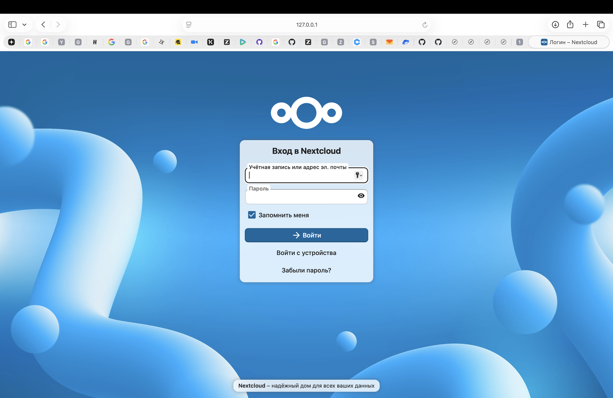
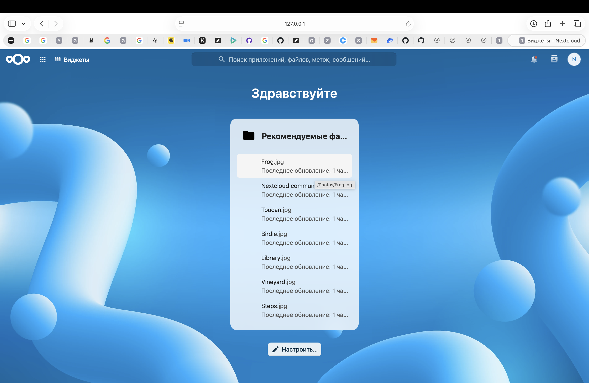
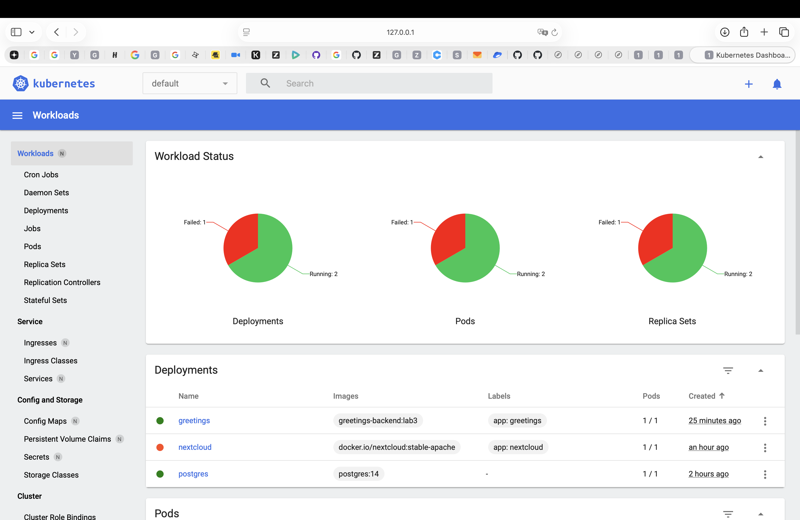
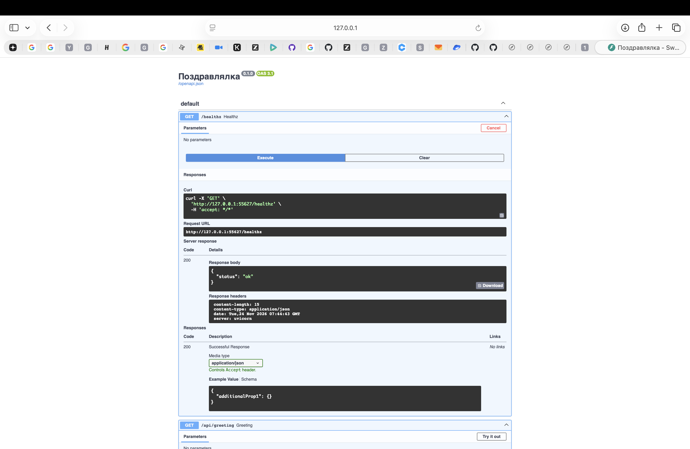

# ЛР 3. Kubernetes (minikube): Nextcloud + PostgreSQL

Задача — развернуть в локальном minikube связку Nextcloud + PostgreSQL из
YAML-манифестов, а затем доработать пример из методички:

1. **postgres**: `POSTGRES_USER` и `POSTGRES_PASSWORD` перенесены из ConfigMap
   в **Secret** (новый манифест `pg_secret.yml`);
2. **nextcloud**: «плоские» переменные (`NEXTCLOUD_UPDATE`,
   `ALLOW_EMPTY_PASSWORD`, `POSTGRES_HOST`, `POSTGRES_DB`,
   `NEXTCLOUD_TRUSTED_DOMAINS`, `NEXTCLOUD_ADMIN_USER`) перенесены из
   Deployment в **ConfigMap** (новый манифест `nextcloud_configmap.yml`);
3. **nextcloud**: добавлены **readiness- и liveness-пробы** (`httpGet
   /status.php`).

Сверх задания: связка с приложением из ЛР 1 (раздел ниже), ИБ-аудит с
hardening и несколько «боевых» фиксов, без которых свежий
`nextcloud:stable-apache` (34.0.6) с `postgres:14` в k8s не разворачивается —
полный разбор в [notes/DEBUG_NOTES.md](notes/DEBUG_NOTES.md).

Окружение: macOS (arm64), Docker Desktop, minikube v1.39.0 (драйвер docker,
CNI calico — для исполнения NetworkPolicy), kubectl v1.37.2, Kubernetes v1.37.0.

## Что где лежит

```
lab3/
  original/                    # манифесты из методички — «как было»
    pg_configmap.yml           #   DB + USER + PASSWORD в ConfigMap
    pg_service.yml             #   NodePort
    pg_deployment.yml
    nextcloud.yml              #   Secret (пароль админа) + Deployment, без проб
  pg_configmap.yml             # «как стало»: только POSTGRES_DB
  pg_secret.yml                # NEW: postgres-secret (USER, PASSWORD)
  pg_service.yml               # ClusterIP (ИБ-аудит; в методичке был NodePort)
  pg_deployment.yml            # envFrom: configMapRef + secretRef + init-SQL + PVC
  pg_init_configmap.yml        # NEW: init-SQL: демоушн роли, REVOKE, db_owner
  pg_pvc.yml                   # NEW: PVC 2Gi под данные postgres
  nextcloud_configmap.yml      # NEW: плоские переменные nextcloud
  nextcloud_secret.yml         # NEXTCLOUD_ADMIN_PASSWORD
  nextcloud_pvc.yml            # NEW: PVC 5Gi под /var/www/html
  nextcloud_deployment.yml     # envFrom + liveness/readiness пробы + volume
  networkpolicy.yml            # NEW: default-deny + точечные разрешения
  lab1-app/                    # бонус: приложение из ЛР 1 в этом же кластере
    greetings_configmap.yml    #   env-контракт бэкенда
    greetings_pvc.yml          #   PVC 100Mi под /data
    greetings_service.yml      #   NodePort 8000
    greetings_deployment.yml   #   образ из lab1 + пробы /healthz + hardening
  screenshots/                 # скриншоты UI
  notes/                       # вынесенные подробности:
    OUTPUTS.md                 #   полные выводы терминала по ходу работы
    DEBUG_NOTES.md             #   полный разбор отладки
    SECURITY_AUDIT.md          #   полный ИБ-аудит и hardening
  README.md                    # этот отчёт
```

Пароли в манифестах — учебные (`PgLab3-2026`, `NcLab3-2026`); репозиторий
учебный, в реальном окружении секреты так в git не кладут.

## Ход работы

Полные выводы команд — в [notes/OUTPUTS.md](notes/OUTPUTS.md); здесь ключевые.

### 1. Запуск кластера

```bash
minikube start --driver=docker --cpus=2 --memory=4096   # (+ --cni=calico для NetworkPolicy)
kubectl get nodes        # minikube Ready, v1.37.0
```

### 2. Исходные манифесты (как в методичке)

```bash
kubectl create -f original/pg_configmap.yml -f original/pg_service.yml -f original/pg_deployment.yml
kubectl get all,cm       # под postgres, NodePort 5432, configmap с 3 ключами
kubectl logs -l app=postgres   # initdb: "database cluster will be initialized..."
kubectl create -f original/nextcloud.yml
kubectl logs -l app=nextcloud  # "Initializing nextcloud 34.0.6.2 ..."
```

Секрет при просмотре содержимого не раскрывает:

```
$ kubectl describe secret nextcloud-secret | tail -1
NEXTCLOUD_ADMIN_PASSWORD:  11 bytes
```

### 3. Порядок манифестов (демо к вопросу 1)

Убираем исходные объекты и применяем доработанные — нарочно начиная с
деплоймента nextcloud, пока его ConfigMap/Secret не созданы:

```
$ kubectl create -f nextcloud_deployment.yml   # первым!
$ kubectl get pods
nextcloud-b7d9d8fdc-c6xq7   0/1   CreateContainerConfigError

$ kubectl describe pod -l app=nextcloud | tail -1
Error: configmap "nextcloud-configmap" not found
```

Создаём остальные объекты — и тот же под оживает без пересоздания:

```
$ kubectl create -f pg_configmap.yml -f pg_secret.yml -f pg_init_configmap.yml \
  -f pg_pvc.yml -f pg_service.yml -f pg_deployment.yml -f nextcloud_configmap.yml \
  -f nextcloud_secret.yml -f nextcloud_pvc.yml
$ kubectl get pods
nextcloud-b7d9d8fdc-c6xq7   0/1   Running   # оживилcя
postgres-848ffcb678-nd8dh   1/1   Running
```

### 4. Доработанная конфигурация: установка и пробы

Установка завершается (`Nextcloud was successfully installed` → `Initializing
finished`), под становится 1/1. Пробы в `describe`:

```
    Liveness:   http-get http://:http/status.php delay=120s timeout=5s period=30s successThreshold=1 failureThreshold=5
    Readiness:  http-get http://:http/status.php delay=30s timeout=5s period=10s successThreshold=1 failureThreshold=3
    Environment Variables from:
      nextcloud-configmap  ConfigMap  Optional: false
      postgres-secret      Secret     Optional: false
```

Секреты хранятся в base64 и декодируются ровно в значения манифеста:

```
$ kubectl get secret postgres-secret -o jsonpath='{.data.POSTGRES_USER}' | base64 -d
nc_dbuser
```

### 5. Доступ снаружи (NodePort)

```bash
kubectl expose deployment nextcloud --type=NodePort --port=80
minikube service nextcloud --url     # http://127.0.0.1:<port>
curl <url>/status.php                # 200, {"installed":true,...}
```

Вход в UI: логин `ncadmin`, пароль из `nextcloud_secret.yml`:



Рабочий стол после входа:



### 6. Dashboard

```bash
minikube dashboard --url
```

Workloads: все деплойменты зелёные (greetings, nextcloud, postgres):



### 7. Эксперимент: scale postgres 0 → 1

Проводился до добавления `pg_pvc.yml` — без PVC результат именно такой, как
в вопросе 2 (полный вывод — notes/OUTPUTS.md):

```
$ kubectl scale deployment postgres --replicas=0 && kubectl scale deployment postgres --replicas=1
$ kubectl exec deploy/postgres -- psql -U nc_dbuser -d nextcloud \
    -c "SELECT count(*) FROM pg_tables WHERE schemaname='public';"
      0                    # база пустая: writable-слой пода умер

$ kubectl get pods
nextcloud-94d7d599-c8x4t   0/1   Running   # readiness: timeout/500 — БД пуста
```

## Что изменено и почему

**Secret вместо ConfigMap для кредов postgres.** ConfigMap — открытое
хранилище: значения видны любому с доступом к API и утекают в логи/экспорты.
`POSTGRES_USER`/`POSTGRES_PASSWORD` — учётные данные, им место в Secret
(base64 + отдельные механизмы RBAC, возможность шифрования etcd). В ConfigMap
осталась только нечувствительная настройка `POSTGRES_DB`.

**ConfigMap для переменных nextcloud.** `NEXTCLOUD_UPDATE`,
`ALLOW_EMPTY_PASSWORD`, `POSTGRES_HOST`, `POSTGRES_DB`,
`NEXTCLOUD_TRUSTED_DOMAINS`, `NEXTCLOUD_ADMIN_USER` — конфигурация, не
секреты. Вынос в ConfigMap делает Deployment переиспользуемым между
окружениями; `NEXTCLOUD_ADMIN_PASSWORD` осталась в Secret, а креды postgres
nextcloud получает через `envFrom: secretRef: postgres-secret` — один
источник правды на оба контейнера.

**Пробы.**

- `readinessProbe` (delay 30 s, period 10 s) — пока `/status.php` не отвечает
  200, под не получает трафик; в эксперименте scale 0→1 именно readiness
  первым сообщил о сломанной БД.
- `livenessProbe` (delay 120 s, period 30 s, timeout 5 s, failureThreshold 5)
  — перезапускает зависший контейнер; пороги мягкие, чтобы не убивать под при
  медленной установке (дефолтный `timeoutSeconds: 1` нас однажды убил — см.
  notes/DEBUG_NOTES.md).
- Путь `/status.php` лёгкий и есть в официальном образе; порт по имени `http`.
  Kubelet шлёт `Host: <IP пода>`, на который Nextcloud отвечает 400, поэтому
  в пробы добавлен `httpHeaders: Host: localhost` (он в trusted domains).

**ИБ-hardening** (по итогам аудита, подробности —
[notes/SECURITY_AUDIT.md](notes/SECURITY_AUDIT.md)): postgres-service →
ClusterIP; NetworkPolicy default-deny с единственной разрешённой цепочкой
nextcloud→postgres:5432; init-SQL отдаёт системные БД роли `db_owner`,
снимает с `nc_dbuser` суперправа и делает `REVOKE CREATE ON SCHEMA public
FROM PUBLIC`; подам не монтируется SA-токен и не раздаются сервис-линки;
greetings работает non-root без capabilities и с read-only rootfs;
postgres переведён на `postgres:14-alpine`; данные postgres и nextcloud
живут на PVC.

## Отладка (кратко)

Актуальный `stable-apache` (NC 34) с суперпользователем БД включает сломанное
«отделение пользователя БД» (роли `oc_admin…oc_admin39` → permission denied),
лечится init-SQL из `pg_init_configmap.yml`. Рестарт контейнера стирает
writable-слой — без PVC nextcloud не переживал перезапуски («Login already
used»), с `nextcloud_pvc.yml` переустановок ноль. Полный разбор с командами и
выводами — [notes/DEBUG_NOTES.md](notes/DEBUG_NOTES.md).

## Связка с ЛР 1: своё приложение в том же кластере

Дополнительно в тот же кластер развернут **бэкенд из ЛР 1** («поздравлялка»
на FastAPI) — сразу по практикам, которых не было в примере задания:

- свой образ (`docker build` по «хорошему» Dockerfile из ЛР 1 →
  `minikube image load`, без registry);
- ConfigMap с env-контрактом (`LLM_MODEL`, `RATE_LIMIT_RPM`, …); без
  `LLM_BASE_URL` приложение честно уходит в fallback:

  ```
  $ curl <url>/api/greeting
  {"date":"2026-11-24","holiday":null,"greeting":"Тёплого осеннего дня!","source":"fallback"}
  ```

  

- пробы `/healthz` (тот же endpoint, что HEALTHCHECK образа из ЛР 1);
- PVC под `/data`: `history.jsonl`, записанный старым подом, пережил удаление
  пода — живой контраст с экспериментом scale 0→1.

```
NAME                             READY   STATUS    RESTARTS   AGE
pod/greetings-65f55bd7db-dphnf   1/1     Running   0          1m
pod/nextcloud-5984d49f9-mr7rq    1/1     Running   0          54m
pod/postgres-75b8c699bf-hqzt6    1/1     Running   0          54m
```

### Развернуть всё одной командой

```bash
minikube start --driver=docker --cpus=2 --memory=4096 --cni=calico

kubectl create -f pg_configmap.yml -f pg_secret.yml -f pg_init_configmap.yml \
  -f pg_pvc.yml -f pg_service.yml -f pg_deployment.yml -f nextcloud_configmap.yml \
  -f nextcloud_secret.yml -f nextcloud_pvc.yml -f nextcloud_deployment.yml \
  -f networkpolicy.yml
```

Порядок файлов не важен (см. вопрос 1). Сверено на чистом кластере: все поды
`1/1 Running` за ~2 минуты, установка завершается без ошибок.

## Ответы на вопросы

**1. Важен ли порядок применения манифестов?**

Нет, объекты в кластере создаются независимо и не «знают» друг о друге —
kubectl create для каждого файла самодостаточен. Но есть практический нюанс:
если Deployment применяется раньше ConfigMap/Secret, на которые ссылается его
`envFrom`, kubelet не может собрать контейнер, и под висит в
`CreateContainerConfigError`, пока недостающий объект не появится (раздел 3:
под «ожил» сразу после создания конфигмапы, без пересоздания). То есть порядок
влияет на момент готовности, но не на результат.

**2. Что (и почему) произойдёт, если отскейлить postgres в 0, затем в 1, и
зайти в Nextcloud?**

При `--replicas=0` Deployment удаляет под вместе с его writable-слоем — без
PersistentVolume данные БД живут ровно столько, сколько живёт под. При
`--replicas=1` новый под делает чистый initdb и инициализирует **пустую** базу
с теми же кредами из Secret. Конфигурация Nextcloud уцелела (config.php в его
собственном поде/томе), поэтому он подключается, но не находит своих таблиц:
приложение отвечает ошибкой, readiness уходит из 200 (у нас — таймауты и
500), под становится 0/1, liveness со временем перезапустит контейнер — что не
поможет. Вывод: БД в k8s нужен PVC, пережидающий пересоздание пода (раздел 7
зафиксировал ровно эту ситуацию; `pg_pvc.yml` добавлен после эксперимента).

## Проверка

| Проверка | Результат |
|---|---|
| `kubectl get all,cm,secret` | всё Running/Ready, объекты на месте |
| `kubectl describe pod nextcloud-*` | видны readiness/liveness пробы и envFrom |
| `kubectl get secret -o yaml` + `base64 -d` | значения совпадают с манифестом |
| `curl /status.php` | HTTP 200, `installed:true` |
| Логин `ncadmin` + пароль из Secret | вход в UI успешен (screenshots/) |
| scale postgres 0 → 1 | база пустая (0 таблиц), пробы 500/timeout, под 0/1 |
| Порядок манифестов | деплоймент первым → `CreateContainerConfigError`, оживает после ConfigMap |
| NetworkPolicy | greetings→postgres блокируется, nextcloud→postgres 200 |
